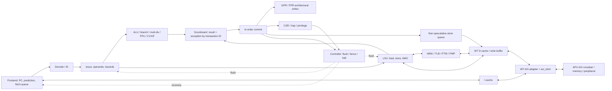

# 04 — Mô hình kiến trúc

`CFG-01` có một core với issue theo thứ tự, nhiều đơn vị thực thi có thể trả kết quả ở thời điểm khác nhau, và commit theo thứ tự qua scoreboard. Hai cổng commit không biến frontend thành dual issue. Mô hình bên dưới dựng từ kết nối source [cva6.sv](../../core/cva6.sv#L700), không phải elaborated hierarchy.

Các mũi tên mô tả quan hệ chức năng, không biểu diễn số stage/cycle. Request/response, flush và commit là các sự kiện khác nhau; đường PTW dùng D-cache nên instruction miss có thể phụ thuộc data-side resource.

## Ai sở hữu state

| Block | State chính | Khi trở thành kiến trúc / được giải phóng |
|---|---|---|
| Frontend | `npc_q`, predictor tables, instruction queue | Speculative; redirect/flush có thể hủy |
| Issue/read operands | Operand pipeline, raw/structural hazard bookkeeping | Forwarding chưa phải register-file commit |
| Scoreboard | `mem_q[].issued`, `sbe.valid`, result/ex, issue/commit pointers | Slot được cấp lúc issue accepted, trả lúc commit/flush |
| Execution units | FU pipeline, division/FP operation đang xử lý | Writeback vào scoreboard trước retirement |
| Commit | Quyết định ack/we/CSR/LSU commit | Ranh giới retirement; port 1 phụ thuộc port 0 |
| GPR/FPR | Architectural operand state | Cập nhật qua commit write enables; không suy reset payload từ valid metadata |
| CSR | privilege, interrupt masks/pending, trap context, satp, debug/WFI | Side effect phụ thuộc CSR/trap operation và priority |
| Store buffer | Speculative queue + committed queue | Commit chuyển ownership; flush không xóa queue committed |
| Load buffer | ID/address/op metadata, valid/flushed flags | Response được thu về; flushed response không tạo normal writeback |
| MMU/PTW | TLB entries, current walk, PTE/address/ASID | Walk fill khi hợp lệ; flush/retry phải quản lý in-flight |
| WT cache | Cache tags/data; write-buffer byte dirty/valid/txblock, tx slots | Store grant nhận ownership nội bộ; AXI return dọn transaction |
| APU | Xbar outstanding routes; SRAM/ROM; CLINT timer; debug state | Reset domains và decode thuộc integration boundary |

Nguồn state: [scoreboard](../../core/scoreboard.sv#L93), [load buffer](../../core/load_unit.sv#L140), [store buffer](../../core/store_buffer.sv#L62), [WT buffer](../../core/cache_subsystem/wt_dcache_wbuffer.sv#L160), [CSR](../../core/csr_regfile.sv#L274).

## Tách core khỏi hệ thống

Core không tự quy định toàn bộ peripheral map: `boot_addr_i`, hart ID, interrupts và NoC boundary đến từ wrapper. Trong harness, hai upstream AXI ports tương ứng core và debug system-bus access; mười downstream regions gồm DRAM, peripheral, ROM, debug. `NrSlaves` đặt tên theo phía xbar, không có nghĩa chỉ hai thiết bị memory.

Harness dùng SRAM behavioral để phục vụ DRAM region, có mock/error peripherals và `test_en=0`; không dùng mô hình này làm chứng cứ FPGA DDR controller hoặc UART interrupt thật. Nội bộ FPU, PLIC, debug module vắng mặt do submodule.

## Định lượng và đánh đổi

- 16-byte cache line / 8-byte AXI beat = 2 data beats cho line-fill đầy đủ ở CFG-01. Đây là tỷ số kích thước; không phải latency 2 cycles từ issue đến load retire.
- I-cache: 16384/(4×16)=256 sets; D-cache: 32768/(8×16)=256 sets. Data capacities chưa gồm tags/ECC/replacement/state.
- Scoreboard 8 entries hấp thụ độ trễ FU nhưng head chưa xong chặn commit trẻ hơn. Có thể retire burst 2 lệnh khi đủ điều kiện, nhưng với issue width 1, steady-state retirement của luồng không có macro expansion không vượt quá 1 instruction/cycle dài hạn.
- WT write buffer gom byte writes theo word; số store instructions, số word entries, số outstanding transactions và số AXI IDs không đồng nhất. CFG có 8 word entries, 4 transaction slots; xbar lại cấu hình `MaxMstTrans=1`, `MaxSlvTrans=1`.

Giải thích “buffer giúp tách latency core/bus, WT đơn giản hóa quản lý dirty cache lines nhưng tạo traffic ghi” là **INFERRED**, không phải rationale được tác giả xác nhận hay số liệu PPA. Chưa đo throughput, worst-case service hoặc clock frequency. [OQ-03, OQ-06](13_open_questions.md).
