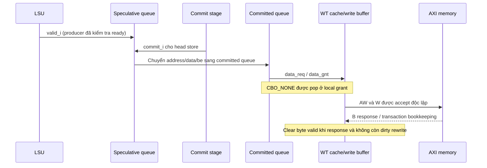

# 09 — Các luồng đầu-cuối

Mọi flow áp dụng BASE-01/CFG-01, source-only. Trình tự là quan hệ nhân quả, không phải trace đã chạy hoặc cam kết số cycle. ASM-01…05 ở [05](05_interfaces.md) là điều kiện chưa được discharge.

## FLOW-01 — Reset → ROM → DRAM → retirement

**Điều kiện:** clock chạy, rst_ni hợp lệ, boot address static, ROM/SRAM và firmware phù hợp. Reset đặt PC-init/CSR-init flags, privilege M, scoreboard/load/store metadata rỗng. Harness dùng rstgen tạo ndmreset_n.

1. Frontend reset-load lấy ROMBase=0x10000; I-cache nhận fetch request. Translation chưa bật từ satp reset.
2. I-cache miss gửi request qua WT adapter → AR channel → xbar ROM rule → axi2rom → bootrom.
3. ROM data quay qua R channel/adapter → I-cache/frontend queue → decode → issue. Scoreboard cấp ID; FU kết quả đánh dấu slot valid; commit ack cập nhật registers theo instruction.
4. Boot assembly chuẩn bị a0=mhartid, a1=DTB, jump 0x80000000; fetch tiếp qua SRAM-backed DRAM region.
5. “Boot thành công” cần observation signature/ELF exit và kiểm tra architected state; chưa có trong phiên này. ROM/ELF mismatch, bus stall/error và branch redirect có thể ngăn hoàn tất.

**Nguồn:** [frontend PC](../../core/frontend/frontend.sv#L347), [ROM assembly](../../corev_apu/bootrom/bootrom.S#L1), [harness](../../corev_apu/tb/ariane_testharness.sv#L634), [scoreboard](../../core/scoreboard.sv#L160). **Gap:** OQ-01/04/09; thời gian boot và checksum ROM chưa được quan sát.

## FLOW-02 — Load, TLB miss, cache response

**Trigger:** load được issue với operands hợp lệ. LSU tính VA/alignment, MMU kiểm tra translation/PMP; load buffer giữ metadata cho request đã được cache grant.

1. Load unit chờ page-offset conflicts với stores và resource/translation conditions. Khi request được chấp nhận, record load ID/address/type.
2. DTLB hit cung cấp PA; nếu miss, PTW giữ VA/ASID/current level và đọc PTE qua D-cache. Với Sv39, có tối đa ba level walk cho translation thông thường không hypervisor, không đồng nghĩa ba cycle.
3. PTW phân tích PTE, permission/page alignment; fill TLB hoặc trả exception. D-cache hit/miss path trả data; miss cần AXI request/response và refill.
4. `data_rvalid` chọn đúng load metadata, sign/zero extension theo op; nếu slot không flushed thì tạo writeback ID/result → scoreboard → in-order commit.
5. Lỗi translation/PMP đưa exception metadata; errors từ AXI còn giới hạn FND-AXI-01. Stall có thể kéo dài vô hạn nếu downstream không service.

**State:** load FSM/ldbuf, PTW FSM/pointers/PTE, cache miss/trans ID, scoreboard result/ex. **Nguồn:** [load_unit](../../core/load_unit.sv#L246), [MMU](../../core/cva6_mmu/cva6_mmu.sv), [PTW](../../core/cva6_mmu/cva6_ptw.sv#L338). **Checks cần:** accepted-request scoreboard, cross load/flush/translation fault, response ID reuse; OQ-03/04/06.

## FLOW-03 — Store từ speculative đến AXI completion

**Trigger:** store được issue, địa chỉ/dữ liệu hợp lệ; store queue còn chỗ. **Điểm cần giữ:** có ba lần chuyển ownership.

Flush hủy speculative queue, giữ committed queue; reset xóa cả hai state queues. Store retire không đợi trực tiếp B ở store_buffer: WT write buffer nhận trách nhiệm tiếp. Downstream stall giữ queue occupied, có thể ngăn commit và issue. Load hazard so `[11:3]` yêu cầu drain khi offset trùng, không chứng minh full-address store-to-load forwarding.

**Completion:** architectural store commit, cache acceptance và bus B completion phải ghi riêng. **Nguồn:** [store_buffer](../../core/store_buffer.sv#L94), [WT buffer](../../core/cache_subsystem/wt_dcache_wbuffer.sv#L514), [axi_shim](../../core/axi_shim.sv#L109). **Unknown:** late write error visibility và progress bound; OQ-03/04/06.

## FLOW-04 — FENCE / FENCE.I / SFENCE.VMA

**Trigger:** fence ở head scoreboard. [cva6.sv:1151](../../core/cva6.sv#L1151) tạo `no_st_pending_commit = no_st_pending_ex & dcache_commit_wbuffer_empty`. Commit chỉ phát fence/ack khi drain phù hợp.

- FENCE: head chờ no_st_pending; controller redirect/flush pipeline. DcacheFlushOnFence=0 nên không yêu cầu D-cache flush bằng flag này trong WT CFG-01.
- FENCE.I: chờ drain, phát I-cache flush và pipeline recovery. DcacheFlushOnFenceI=0 ở CFG-01; không suy behavior của WB từ đây.
- SFENCE.VMA: điều kiện `no_st_pending_i && !shared_tlb_flush_busy_i`; flush TLB/pipeline. UseSharedTlb=0 không có nghĩa bỏ qua mọi PTW/TLB control path.

**Concurrency:** store đã rời committed queue nhưng WB chưa rỗng vẫn phải chặn fence. Flush+new fetch/load cần không đưa stale instruction/data vào retirement. **Nguồn:** [commit](../../core/commit_stage.sv#L143), [controller](../../core/controller.sv#L119). **Gap:** không có tự sửa code rồi FENCE.I run, PTW+SFENCE test hoặc assertion witness; OQ-03.

## FLOW-05 — Mispredict, exception và load response sau flush

Branch unit gửi resolved target/mispredict. Controller mispredict chỉ bật `flush_unissued_instr_o` và frontend flush tại nhánh đầu; exception/eret/debug entry kích pipeline flush rộng hơn và predictor flush. Frontend NPC priority tới cuối combinational block quyết định redirect cuối cùng khi nhiều điều kiện cùng xuất hiện.

Nếu load đang outstanding khi flush: ldbuf không xóa sạch nghĩa vụ response; đánh dấu flushed. Grant cùng flush vẫn có flushed bit=1 do assignment flush đặt sau allocation. Response sau đó phải được thu/dọn mà không tạo normal load writeback; scoreboard cũng kiểm `issued` trước nhận FU writeback. Kiểm `issued` đơn lẻ không chứng minh an toàn mọi trường hợp ID tái sử dụng: còn cần producer suppress/drain đúng epoch.

**Completion:** fetch chuyển tới đúng target và instruction cũ không retirement. **Nguồn:** [controller](../../core/controller.sv#L114), [load flag priority](../../core/load_unit.sv#L160), [response guard](../../core/load_unit.sv#L492), [scoreboard](../../core/scoreboard.sv#L198). **Gap:** current RTL có cơ chế phòng race; chưa có simulation tái hiện hay kiểm chứng toàn sequence, OQ-03.

## FLOW-06 — Timer IRQ / WFI → trap → return

RTC level đi qua synchronizer/edge detector, tăng mtime trừ khi software write cùng cycle thắng. `mtime>=mtimecmp` đưa timer_irq high; CSR cập nhật MTIP, mie/global enable/delegation/privilege quyết định khả năng trap. WFI có thể wake theo điều kiện riêng trước khi trap delivery.

Trap metadata đi tới retirement boundary; CSR ghi cause/epc/status, controller flush, frontend chọn trap vector. Handler phải xử lý nguồn: đặt mtimecmp lớn hơn current mtime để deassert timer condition; mret/sret khôi phục privilege/interrupt stack theo CSR control. Việc ghi mip đơn thuần không clear time_irq đang high.

**Backpressure:** head instruction chưa hoàn tất hoặc halt/exception priority ảnh hưởng thời điểm nhận trap; không có latency bound đo được. **Nguồn:** [CLINT](../../corev_apu/clint/clint.sv#L90), [CSR](../../core/csr_regfile.sv#L2079), [commit exception](../../core/commit_stage.sv#L379). **Gaps:** masked-pending/wake/trap race, PLIC claim/complete và reset IRQ; OQ-03/05/08.

## FLOW-07 — Debug và partial reset

JTAG/DMI/SimDTM là các stimulus paths tới debug module; module đưa debug_req vào core và có AXI manager để truy cập memory. Core vào debug PC `DmBaseAddress+HaltAddress = 0x800` theo CFG-01; `ExceptionAddress=0x808` là debug-related configuration, không phải normal reset vector.

`ndmreset` đi qua reset generator để restart core/interconnect/peripherals; debug system path có thể giữ hoạt động. Cần chứng minh transaction cũ không quay về epoch mới và memory state/ROM handoff theo reset contract. Trace/debug output chỉ quan sát được những signal được nối, không là bằng chứng formal completeness.

**Nguồn:** [ariane_testharness](../../corev_apu/tb/ariane_testharness.sv#L119), [frontend debug redirect](../../core/frontend/frontend.sv#L410). **Gap:** riscv-dbg submodule thiếu, chưa trace CDC/DMI/backpressure trong IP hoặc reset mid-burst, OQ-02/05.
