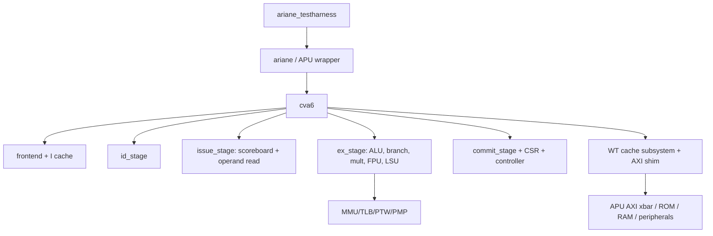

# 01 — Bản đồ repository

## Đường build và top

`Makefile` chọn target/package; [core/Flist.cva6](../../../core/Flist.cva6) định nghĩa compile set/order cho một flow. [Bender.yml](../../../Bender.yml) và [ariane.core](../../../ariane.core) là flow độc lập, không bảo đảm cùng dependency/version. Simulation harness nằm ở [corev_apu/tb/ariane_testharness.sv](../../../corev_apu/tb/ariane_testharness.sv); CPU module là [core/cva6.sv](../../../core/cva6.sv#L18). Verilator top, testbench top, synthesis top phải ghi theo command thực chạy; tên `cva6` không tự động là top của mọi flow. Baseline chi tiết: [03 của thư mục cha](../03_build_and_configuration.md).

Đây là hierarchy chức năng từ instantiation/generate ở [cva6.sv](../../../core/cva6.sv#L705), [LSU](../../../core/cva6.sv#L1660) và [cache branch](../../../core/cva6.sv#L1465). Chưa có elaborated hierarchy dump. Một file trong flist không đồng nghĩa instance active; cache WT được chọn từ `DCacheType`, alternative cache modules vẫn có thể hiện diện trong compile set.

## Source theo vai trò

| Vai trò | Source trọng tâm |
|---|---|
| ISA/CSR/config types | [riscv_pkg](../../../core/include/riscv_pkg.sv), [ariane_pkg](../../../core/include/ariane_pkg.sv), [config](../../../core/include/cv64a6_imafdc_sv39_config_pkg.sv) |
| Fetch/decode | [frontend](../../../core/frontend/frontend.sv), [instr_queue](../../../core/frontend/instr_queue.sv), [compressed_decoder](../../../core/compressed_decoder.sv), [decoder](../../../core/decoder.sv) |
| Issue/retire | [issue_read_operands](../../../core/issue_read_operands.sv), [scoreboard](../../../core/scoreboard.sv), [commit_stage](../../../core/commit_stage.sv) |
| Memory/protection | [LSU](../../../core/load_store_unit.sv), [load](../../../core/load_unit.sv), [store buffer](../../../core/store_buffer.sv), [MMU](../../../core/cva6_mmu/cva6_mmu.sv), [WT cache](../../../core/cache_subsystem/wt_cache_subsystem.sv) |
| Control/observation | [controller](../../../core/controller.sv), [CSR](../../../core/csr_regfile.sv), [RVFI](../../../core/cva6_rvfi.sv), [performance](../../../core/perf_counters.sv) |

Các submodule vendor chưa đủ để chứng nhận hệ thống APU chạy end-to-end trong checkout. Build smoke/elaboration và dependency lock là [câu hỏi mở](09_open_questions.md).
