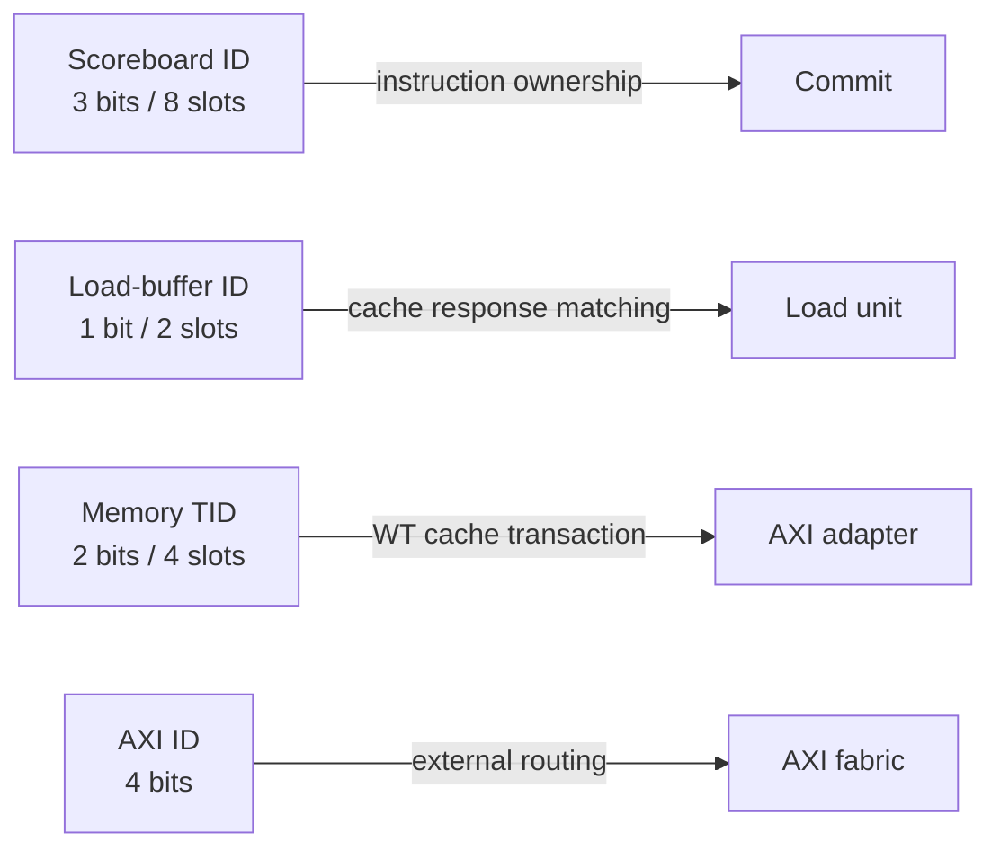

# 01 — Selected and Derived Configuration

The table below is **RTL-ESTABLISHED** from [target inputs](../../../../core/include/cv64a6_imafdc_sv39_config_pkg.sv#L11) and [derived configuration](../../../../core/include/build_config_pkg.sv#L3). It is accepted by the complete core compile. Runtime display confirmation remains open.

| Domain | Active value | Microarchitectural consequence |
|---|---:|---|
| XLEN / VLEN / PLEN | 64 / 64 / 56 | 64-bit integer datapath and 56-bit physical-address container. |
| Virtual memory | Sv39, 3 PT levels | 27 VPN bits, 16-bit ASID, independent 16-entry ITLB and DTLB. |
| Issue / commit | 1 / 2 | One instruction can allocate per cycle; a ready backlog can drain through two restricted commit ports. |
| Scoreboard | 8 entries, 3-bit transaction ID | Ring allocation/commit pointers address eight ownership slots. |
| Writeback ports | 5 | FLU, LSU load, LSU store, FPU/ALU2, and CV-X-IF-related result plumbing are represented in the top-level arrays. |
| Integer units | 1 ALU, no ALU lane bypass | Superscalar-only second-lane logic is inactive. |
| FP | F and D enabled, FLEN 64 | FPU state and FPR paths are active; vector FP is inactive. |
| ISA options | A, B, ZKN, C, Zcb, ZiCond enabled | AMO, bit manipulation/crypto, compressed decode, and conditional-zero paths are active. |
| Disabled ISA options | H, V, Zcmp, Zcmt, Zicbom | Hypervisor/vector/macro-compressed/CBO-specific branches are inactive. |
| CV-X-IF | Interface enabled; `COPRO_NONE` | Driver/FU logic exists; no selected coprocessor is expected to accept extension instructions. |
| Cache choice | WT | `gen_cache_wt` instantiates `wt_cache_subsystem`; HPDCache/WB branches are inactive. |
| I-cache | 16 KiB, 4-way, 128-bit line | 256 sets, 16-byte lines. |
| D-cache | 32 KiB, 8-way, 128-bit line | 256 sets, 16-byte lines; write-through write buffer active. |
| Load buffer | 2 entries | Two response identities exist in the load unit; this is separate from scoreboard IDs. |
| WT write buffer | 8 word entries | Dirty-byte merging and later memory transactions are decoupled from store retirement. |
| D-cache transaction IDs | 2-bit memory TID, 4 slots | `DCACHE_MAX_TX=2**MEM_TID_WIDTH=4`; separate from load-buffer and scoreboard IDs. |
| Store queues | 4 speculative + 4 committed | Defined in `ariane_pkg`; commit transfers ownership between queues. |
| Predictor | BHT, 128 entries; BTB 32; RAS 2 | Dynamic conditional prediction and target/return state are active. |
| PMP | 8 entries, NAPOT enabled | CSR state and fetch/data/PTW protection checks are active. |
| Debug | Enabled, trigger extension disabled | Debug request/mode/DPC/DCSR path active; Sdtrig paths constant-disabled. |
| Performance | Enabled, 6 HPM counters by CSR default | Event mux and counters are instantiated. |
| AXI | 64-bit address/data, 4-bit ID | External bus namespace is independent of internal transaction IDs. |

## Important derived distinctions

These IDs must never be treated as one common namespace. The load buffer stores the scoreboard ID in its payload, allowing a cache response ID to recover the destination scoreboard transaction. [Load buffer](../../../../core/load_unit.sv#L104)

## Configuration consequences for this analysis

- `SpeculativeSb=0`, so superscalar speculative-scoreboard cancellation logic is inactive; branch recovery relies on preventing unissued younger work and the single-issue ordering model.
- `NonIdemPotenceEn=0` because both configured non-idempotent lengths are zero, even though two rule slots exist. The non-idempotent load wait states compile but do not control CFG-01 behavior. [Derived flag](../../../../core/include/build_config_pkg.sv#L150)
- `DcacheFlushOnFence=0` and `DcacheFlushOnFenceI=0`; fences still wait for store queues/write buffer to drain, while a configured D-cache array flush is not required by those flags. [Commit drain](../../../../core/cva6.sv#L1149)
- `UseSharedTlb=0`; ITLB and DTLB remain active, and PTW/shared lookup RTL still participates through the MMU wrapper. The parameter must be followed at generate/use sites rather than interpreted as “no PTW.”
