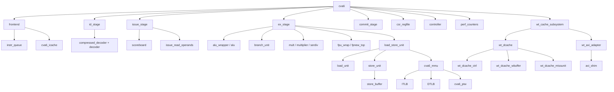

# 02 — Active Hierarchy

The hierarchy is **partially elaborated**: Questa loaded the listed active modules but failed before producing an optimized design. It agrees with the `CVA6Cfg` generate conditions in [cva6.sv](../../../../core/cva6.sv#L705).

## Active top-level generate decisions

| Generate site | CFG-01 result | Evidence |
|---|---|---|
| `CvxifEn` | CV-X-IF driver/FU instantiated | [top](../../../../core/cva6.sv#L830) |
| `CvxifEn && EnableAccelerator` conflict check | false because accelerator disabled | [top](../../../../core/cva6.sv#L873) |
| `PerfCounterEn` | performance counter module instantiated | [top](../../../../core/cva6.sv#L1337) |
| `DCacheType == WT` | WT cache subsystem instantiated | [top](../../../../core/cva6.sv#L1468) |
| `EnableAccelerator` | external vector accelerator dispatcher absent | [top](../../../../core/cva6.sv#L1660) |
| `RVZCMT && !MmuPresent` | Zcmt no-MMU address rules absent | [top](../../../../core/cva6.sv#L1437) |

## Functional ownership

- `frontend` owns speculative fetch PC, prediction, realignment, and instruction buffering.
- `id_stage` owns one single-issue decode slot in CFG-01.
- `scoreboard` owns issued instruction lifetime and in-order head selection.
- `issue_read_operands` owns dependency resolution, forwarding selection, structural admission, and FU input registers.
- execution units produce result/exception plus scoreboard ID; completion can occur out of order.
- `commit_stage` converts ordered completed entries into architectural side-effect enables.
- `csr_regfile` owns privilege, trap/debug context, translation controls, interrupt pending/enables, and architectural counters.
- `controller` distributes redirect-related flushes and fence maintenance requests.
- LSU/MMU/cache blocks own memory requests after their respective handshakes; ownership boundaries are detailed in `memory/`.

## Elaboration limitation

The failed `vopt` backend means instance pruning, parameter values, port binding, and cross-module `always_comb` checks were not emitted as a final optimized database. The hierarchy above is stronger than a filename map because the tool loaded its active dependencies, but it is not a successful full elaboration report.
