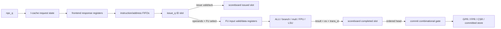
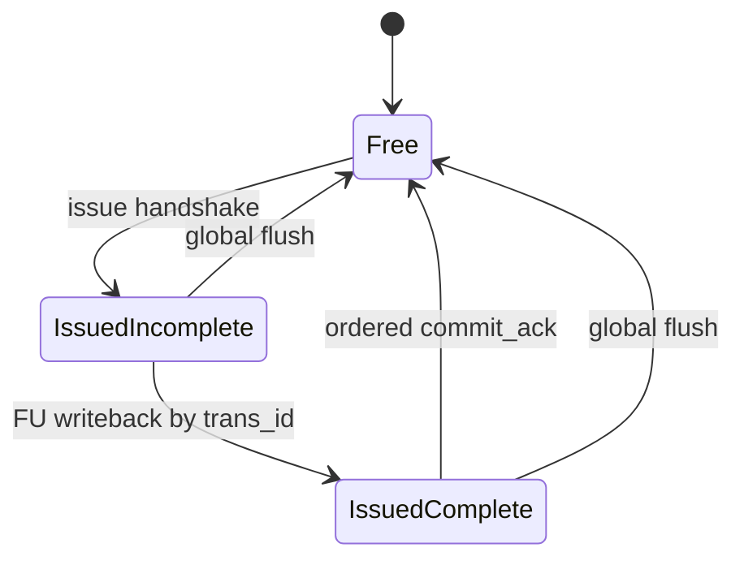

# 03 — Exact Pipeline Occupancy Model

CVA6 uses decoupled buffers and an eight-entry scoreboard rather than a fixed five-stage instruction conveyor. The model below names each state boundary that can independently hold instruction-related state.



## Occupancy rules

### Frontend PC

`npc_q` updates every active clock from `npc_d`; reset clears it and raises `npc_rst_load_q`, which selects `boot_addr_i` in the next combinational evaluation. [NPC selection](../../../../core/frontend/frontend.sv#L355), [registers](../../../../core/frontend/frontend.sv#L421) PC changes do not alone prove an instruction entered the pipeline; I-cache and instruction-queue handshakes establish that.

### Instruction queue

The queue separates instruction payload from fetch addresses. It accepts a fetch packet only when queue/address capacity permits, masks instructions after a predicted control-flow instruction, and asserts replay when an instruction or address cannot be stored. [Admission](../../../../core/frontend/instr_queue.sv#L149), [replay](../../../../core/frontend/instr_queue.sv#L278) Its output valid represents a buffered fetch entry, not a decoded or issued instruction.

### ID slot

For `NrIssuePorts=1`, `issue_q[0]` is the registered ID-to-issue payload. The next-state order is:

```text
issue_n = issue_q
if issue_ack: issue_n.valid = 0
if slot empty after the acknowledgement and fetch valid: load decoded payload
if flush: issue_n.valid = 0
```

Thus a same-cycle issue acknowledgement can make room for the next decoded instruction, while flush has final lexical priority over validity. [ID next state](../../../../core/id_stage.sv#L442), [ID register](../../../../core/id_stage.sv#L473)

### Scoreboard ownership

An instruction becomes scoreboard-owned only on `decoded_instr_valid_i && decoded_instr_ack_o && !flush_unissued_instr_i`. The selected issue pointer becomes its transaction ID. [Allocation](../../../../core/scoreboard.sv#L149) FU completion marks the indexed entry valid and supplies result/exception, provided that slot is still issued. [Completion](../../../../core/scoreboard.sv#L193)



### FU input registers

Each FU valid next value defaults to zero. An instruction with no pre-existing exception and a successful issue handshake raises exactly the selected FU valid. A flush clears all FU valid next values after dispatch selection, so flush wins that cycle. [FU dispatch](../../../../core/issue_read_operands.sv#L737), [FU registers](../../../../core/issue_read_operands.sv#L802)

### Completion and commit

FU completion is out of order by transaction ID; commit reads the scoreboard at `commit_pointer_q` and remains in order. A completed younger entry waits when the head is incomplete. Port 1 can drain the following entry only when port 0 commits and its additional restrictions pass. [Head selection](../../../../core/scoreboard.sv#L135), [port 1](../../../../core/commit_stage.sv#L317)

## Conceptual valid update rules

| Boundary | Exact RTL rule summary |
|---|---|
| ID slot | hold by default; ack clears; replacement fetch may load; flush clears last. |
| FU valid | zero by default; valid+ack selects one FU; flush clears last. |
| Scoreboard issued | allocation sets; commit clears; global flush clears last. |
| Scoreboard completed | FU writeback sets only for an issued slot; commit/global flush clear. |
| Load-buffer valid | response clears; accepted request sets; reset clears. Flush marks entries flushed rather than clearing their response obligation. |
| Speculative store valid | LSU allocation sets; commit transfer clears head; flush clears all speculative entries. |
| Committed store valid | retirement transfer sets; cache grant clears normal store head; ordinary pipeline flush does not clear. |

## Throughput consequence

Single issue bounds long-run ordinary instruction admission to at most one instruction per cycle. Two commit ports can drain a ready backlog in bursts. Scoreboard capacity permits latency overlap but does not remove head-of-line blocking.
