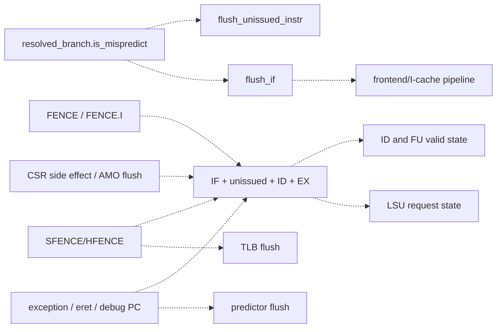

# 05 — Global Stall, Redirect, and Flush Matrix

## Redirect and flush network



The controller uses independent outputs rather than one universal kill. [Controller](../../../../core/controller.sv#L95)

| Producer | Condition | Outputs asserted | State intentionally retained |
|---|---|---|---|
| Branch recovery | resolved branch valid and mispredicted | frontend/IF flush and unissued-instruction flush | older issued scoreboard entries; committed stores; accepted external transactions. |
| FENCE | committed fence request | IF, unissued, ID, EX; optional D-cache flush based on configuration | architecturally committed memory work must drain, not disappear. |
| FENCE.I | committed fence-I request | IF, unissued, ID, EX, I-cache flush; optional D-cache flush | committed stores/write buffer drain before commit grants fence. |
| SFENCE.VMA | committed SFENCE | IF, unissued, ID, EX, selected TLB flush | external memory transactions and committed stores. |
| CSR/accelerator side effect | `flush_csr_i || flush_acc_i` | IF, unissued, ID, EX; frontend restarts at commit PC+4 | committed architectural update. |
| AMO completion | `flush_commit_i` | IF, unissued, ID, EX | completed AMO result and memory effect. |
| Exception, return, debug entry | `ex_valid_i || eret_i || set_debug_pc_i` | IF, unissued, ID, EX, predictor flush | older committed state; accepted memory responses must be drained/suppressed. |
| Reset | `!rst_ni` | asynchronous reset at state owners | external devices in other reset domains are not proven reset. |

## PC-source priority

The frontend next-PC combinational block assigns sources sequentially. Later assignments have mux priority when their conditions overlap:

```text
reset-load initialization
< prediction
< sequential fetch advance
< replay
< branch misprediction
< eret
< exception/interrupt vector
< commit-PC restart for CSR/AMO flush
< debug entry PC
```

[NPC block](../../../../core/frontend/frontend.sv#L355) This is the mux priority, not a proof that every pair can occur simultaneously. The pairwise architectural consequences are recorded in [event priority](control/redirect_priority_matrix.md).

## Stall ownership

| Stall source | Immediate effect | Release |
|---|---|---|
| Instruction queue full | stops I-cache request acceptance/NPC sequential advance | ID consumes entries or redirect flushes queue. |
| ID slot occupied and issue not acknowledged | fetch output not consumed | scoreboard/FU admission succeeds or flush clears ID. |
| Scoreboard full | issue valid not acknowledged | one or two head entries commit, or global flush clears scoreboard. |
| RAW dependency incomplete | `stall_raw`, no issue ack | matching scoreboard/writeback result becomes valid, or flush. |
| FU structural busy | selected issue ack withheld | unit deasserts busy/accepts next operation, or flush if supported. |
| Load-buffer full | new load not accepted | cache response releases an entry. |
| Store-buffer speculative/full or committed/full | LSU or store commit waits | store moves between queues and D-cache grants committed head. |
| DTLB miss | load/store FSM waits while PTW resolves | TLB fill or translation exception. |
| D-cache/memory backpressure | request FSM holds req/state | grant/response/error. No finite bound is established. |
| Fence store drain | commit ack withheld | speculative/committed store path and WT write buffer become empty. |
| Halt/debug control | commit/frontend admission held | CSR/controller removes halt according to debug/WFI/fence state. |

## Priority properties to verify dynamically

1. Flush wins ID replacement and FU dispatch in the same cycle.
2. Load flush wins load-buffer allocation metadata in a simultaneous grant cycle.
3. A committed store is retained across ordinary pipeline flush.
4. A trap/return/debug redirect dominates a branch redirect as described by the PC mux without corrupting saved EPC/DPC.
5. Reset isolates pre-reset responses from post-reset transaction IDs.
