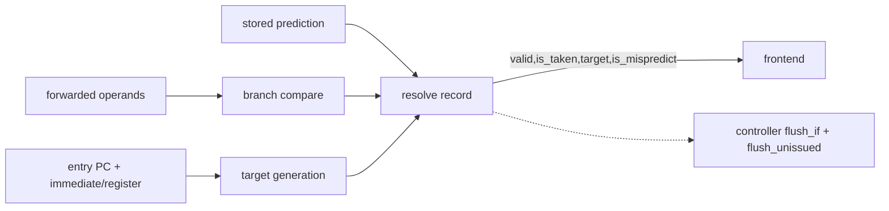

# ALU and Branch Unit

**Evidence level:** RTL-established.

## ALU datapath

`alu` implements arithmetic, logical, shift, compare, bit-manipulation, conditional-zero, and crypto-related integer operations selected by `fu_data.operation`. Operands originate in issue forwarding/immediate muxes. The result joins the fixed-latency writeback path with the scoreboard transaction ID. [ALU](../../../../../core/alu.sv#L17) [Wrapper](../../../../../core/alu_wrapper.sv#L15)

The active configuration has one ALU lane. The EX stage combines one-cycle ALU, branch, CSR, and AES selection into `one_cycle_select`; their result is selected into the fixed latency unit result path. [EX select](../../../../../core/ex_stage.sv#L308)

## Branch resolution

`branch_unit` computes condition and target, compares the actual outcome/target with prediction metadata, and emits `resolved_branch_o`. A correct prediction updates predictor state without a recovery flush. A misprediction redirects the frontend and clears younger unissued work. The branch instruction itself completes through the fixed-latency writeback path. [Branch unit](../../../../../core/branch_unit.sv#L17)

## State, stalls, and exceptions

The arithmetic combinational datapath has no independent queue. Ownership is in the registered issue/FU boundary and then scoreboard/writeback. `flu_ready_i` controls admission. Flush clears the pending FU-valid register before a killed instruction can complete normally. Misaligned control-flow targets or illegal operation metadata propagate as instruction exceptions rather than memory requests.

## Checks

Prove target arithmetic for compressed versus normal links, signed/unsigned compare behavior, no recovery flush for a correct prediction, redirect target correctness, and suppression of a killed branch writeback.
