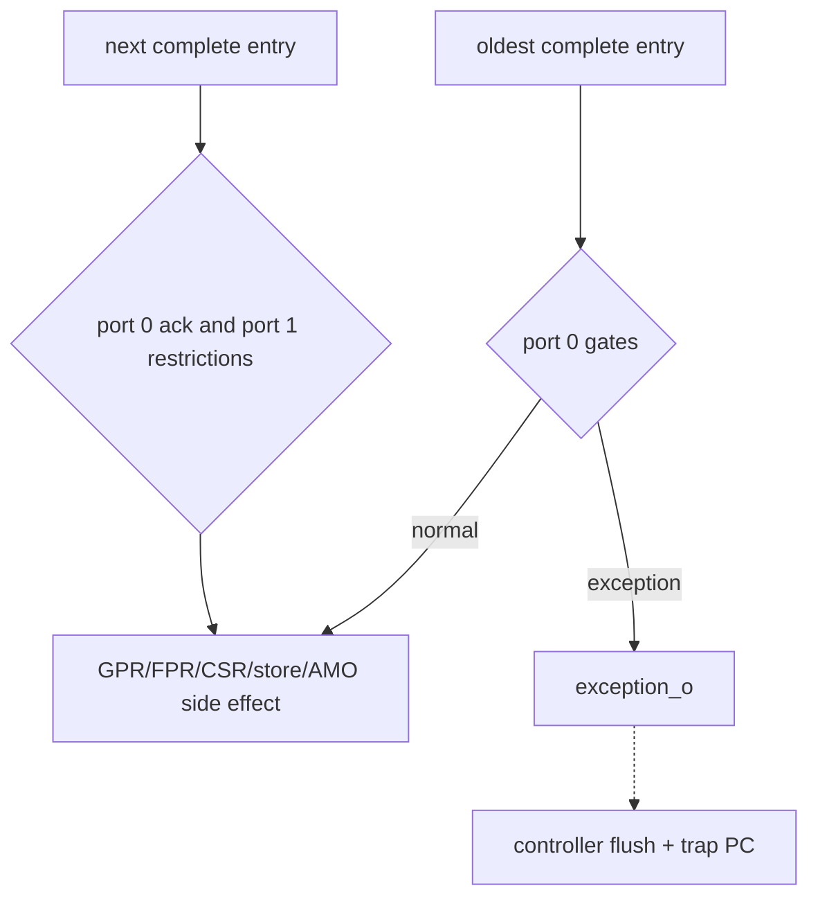

# Commit Stage

**Evidence level:** RTL-established for gates and priorities.

## Retirement rules

Commit observes the oldest two scoreboard entries, but issue remains single-wide. Port 0 can acknowledge a valid completed head when global halt and operation-specific side-effect gates permit it. An exception at the head suppresses the normal architectural result and initiates trap handling. [Commit](../../../../../core/commit_stage.sv#L16)

Store retirement additionally requires `commit_ready_o` from the store buffer. CSR retirement waits for the CSR access result and cannot accompany port 1. Fence instructions wait for documented drain conditions. AMO waits for its commit acknowledgement and causes a pipeline restart/flush after completion.

Port 1 requires port 0 acknowledgement, a valid second entry, no halt, no CSR in port 0, no D-cache flush, no port-0 AMO, no single step, no exception, and an allowed second-entry FU. This makes dual commit a conditional backlog drain path. [Commit acknowledgements](../../../../../core/commit_stage.sv#L180)

## Architectural write gates

GPR and FPR writes are generated only from acknowledged, non-dropped, exception-free entries of the correct destination class. CSR write effects occur through `csr_regfile` at commit. Store commit transfers ownership from speculative to committed queue; it does not mean AXI completion.

## Exception selection

CSR access exceptions are considered at the head, then an earlier exception already carried by the instruction has priority in the later assignment. Interrupts are prioritized in CSR/interrupt logic and presented as an exception event at a precise boundary. Trigger timing state is inactive in CFG-01 because Sdtrig is disabled. [Exception handling](../../../../../core/commit_stage.sv#L378)

## Checks

Assert in-order acknowledgements, port-1 dependency on port 0, no normal side effect for a faulting entry, correct store ownership transfer, fence drain before ack, and exact EPC selection for synchronous exceptions versus interrupts.
