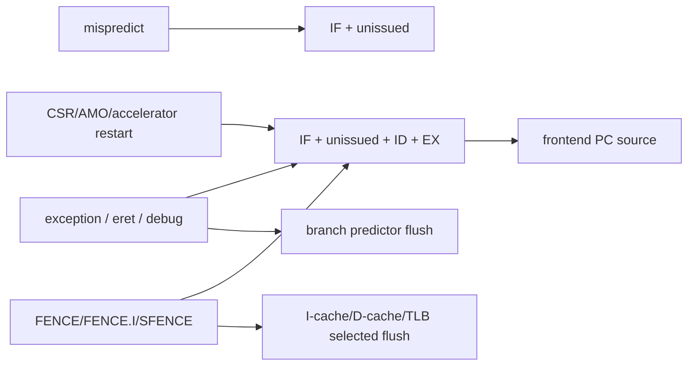

# Global Controller

**Evidence level:** RTL-established.

## Role and outputs

The controller converts branch recovery, trap/return/debug, CSR/accelerator restart, fences, and cache/TLB maintenance requests into distinct flush and PC controls. Outputs include `set_pc_commit_o`, `flush_if_o`, `flush_unissued_instr_o`, `flush_id_o`, `flush_ex_o`, predictor/cache/TLB flushes, and commit halt. [Controller](../../../../../core/controller.sv#L18)

## Priority and persistence

The combinational `flush_ctrl` block starts with all outputs clear and applies event conditions in source order. Cache flush has registered persistence while waiting for `flush_dcache_ack_i`; this can halt commit. Other flush pulses act on the owning blocks' next-state logic. [Flush control](../../../../../core/controller.sv#L95)

A misprediction deliberately has narrow scope. Trap, return, debug, fence, CSR side effect, and commit restart have wider scope. Committed store-buffer entries and already accepted external memory transactions are outside the ordinary pipeline flush domain.

## Checks

The full pairwise order is in [redirect priority matrix](../control/redirect_priority_matrix.md). Assertions should cover exact scope per producer, cache-flush request persistence until acknowledge, no commit during maintenance halt, and restart PC selection consistent with the frontend's later-assignment priority.
