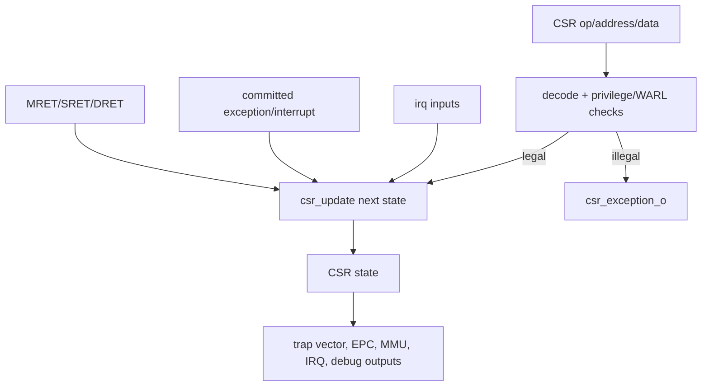

# CSR Register File

**Evidence level:** RTL-established for active CSR state and update logic; exhaustive architectural WARL testing is open.

## Responsibilities

`csr_regfile` implements privilege state, trap delegation/vector/EPC/cause registers, translation controls, interrupt enable/pending state, counters, FP flags/mode, PMP CSRs, cache controls, WFI, and debug CSRs. It also computes CSR access exceptions, trap targets, return targets, effective privilege, and MMU controls. [CSR file](../../../../../core/csr_regfile.sv#L16)

## Access path

CSR operations compute write data for write/set/clear and suppress read/write effects for MRET/SRET/DRET. Privilege or illegal access clears `csr_we/csr_read` and emits illegal-instruction metadata. Address privilege bits, debug-only range checks, and counter-enable masks participate in access validation. [CSR op](../../../../../core/csr_regfile.sv#L2461) [Privilege check](../../../../../core/csr_regfile.sv#L2520)

## Priority and reset

The large `csr_update` block defines software writes and hardware event updates; the sequential block samples its next-state outputs. Trap/debug/return updates can override ordinary CSR writes to the same architectural state according to assignment order. Reset enters M mode, clears status/EPC/cause/translation/delegation state, enables both caches, initializes debug version/privilege, and defers `mtvec` boot-derived loading through `mtvec_rst_load_q`. [Next state](../../../../../core/csr_regfile.sv#L1011) [Sequential reset](../../../../../core/csr_regfile.sv#L2830)

## WFI and interrupts

`wfi_q` sets on a legal WFI outside debug with no exception. It clears for any enabled pending interrupt, debug request, or supervisor external wake input. Global interrupt enable is disabled in debug and constrained by single-step policy. [WFI](../../../../../core/csr_regfile.sv#L2662)

## Outputs and checks

Translation enables only for Sv39 in non-M privilege; MPRV adjusts data-access privilege, with a debug `mprven` exception. Trap vector selection supports direct/vectored behavior and debug exception address. See [CSR inventory](../control/csr_inventory.md), [interrupt acceptance](../control/interrupt_acceptance.md), and [privilege transitions](../control/privilege_transitions.md).
