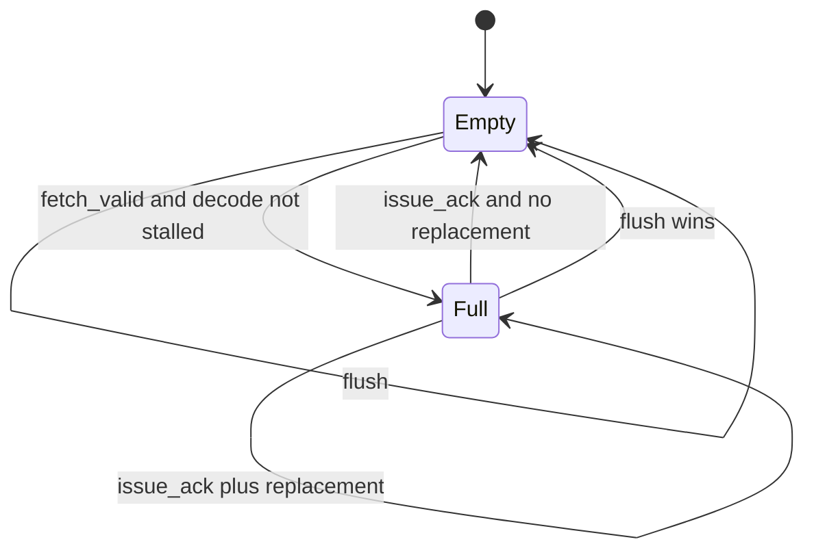

# Decode and ID Register

**Evidence level:** RTL-established for CFG-01 active decode and register rules.

## Datapath

The frontend entry passes through compressed decoding and the main `decoder`, producing a `scoreboard_entry_t` with FU, operation, register addresses, immediate/result fields, control-flow prediction, and exception metadata. Decode starts from safe defaults and marks unsupported or privilege-invalid encodings as exceptions. [ID stage](../../../../../core/id_stage.sv#L17) [Decoder](../../../../../core/decoder.sv#L175)

CFG-01 enables RVC and Zcb, but disables Zcmp/Zcmt. Macro-decode storage and stalls for Zcmt are therefore inactive after constant propagation. CV-X-IF lightweight decode exists, but the selected coprocessor configuration accepts no custom instruction.

## Registered boundary

For the active one-port branch, `issue_q[0].valid` clears on issue acknowledgement, then an empty next slot may accept a fetch entry. The final flush assignment clears valid and therefore wins over same-cycle replacement. Payload can change while invalid; validity defines ownership. [ID next state](../../../../../core/id_stage.sv#L444)

## Backpressure and exceptions

`fetch_entry_ready_o` asserts only when the next ID slot is empty and decode is not stalled. The valid output to issue is the registered valid bit. Existing fetch exceptions pass through and suppress normal architectural interpretation at commit. Decode-generated illegal, breakpoint, ECALL, virtual, and privilege-related conditions are carried in the same exception record.

## Required checks

Assert that flush makes the next registered valid low; an acknowledged instruction is never presented twice; a held valid keeps its payload stable; and every default/illegal decode selects no side-effecting FU path unless its exception record is valid.
