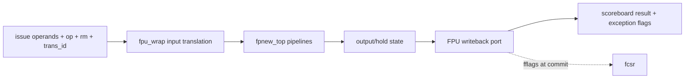

# Floating-Point Unit

**Evidence level:** RTL-established for active configuration and interfaces; latency by operation is open.

## Configuration and datapath

CFG-01 enables F and D with `FLen=64`. `fpu_wrap` translates CVA6 operation encoding, operands, rounding mode, format, and transaction ID into CVFPU `fpnew_top`. Vector formats are inactive. [FPU wrapper](../../../../../core/fpu_wrap.sv#L16) [Implementation parameters](../../../../../core/fpu_wrap.sv#L64)

## Handshake and state

`fpu_ready_o` governs issue admission. The wrapper keeps transaction metadata aligned with CVFPU output and has an FP hold register for output/backpressure cases. `fpu_early_valid_o` exposes early availability to issue hazard logic, while architectural completion uses normal writeback and in-order commit. [Input FSM](../../../../../core/fpu_wrap.sv#L432) [Hold state](../../../../../core/fpu_wrap.sv#L475)

The wrapper's exception object is not a synchronous trap (`fpu_exception_o.valid=0`); IEEE flags travel with the result and update `fcsr.fflags` at architectural commit. Integer-conversion results use the appropriate integer destination path.

## Flush and limits

Flush must invalidate ownership metadata so an old CVFPU output cannot update a recycled scoreboard slot. Operation-dependent pipeline depth and divide/square-root occupancy constrain throughput. Required tests cover mixed short/long operations, output backpressure, fflags retirement, and flush during an outstanding operation.
