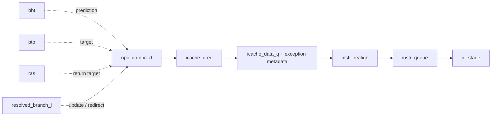

# Frontend

**Evidence level:** RTL-established for structure, mux priority, predictor updates, and cache kills. Cycle latency is open.

## Responsibility and structure

`frontend` owns the next fetch PC, prediction state, accepted I-cache response register, instruction realignment, and the instruction queue. Active predictor state comprises a 128-entry BHT, 32-entry BTB, and two-entry RAS. [Frontend](../../../../../core/frontend/frontend.sv#L18) [Configuration](../01_elaborated_configuration.md)

## State and update priority

The main register bank holds `npc_q`, reset-load state, speculative state, the I-cache response payload and exception metadata, plus registered BHT/BTB lookup output. Reset clears all fields and causes the first combinational selection to load `boot_addr_i`. [State update](../../../../../core/frontend/frontend.sv#L421)

The `npc_select` block is a last-assignment-wins mux. Its exact order is boot initialization, predicted target, sequential accepted fetch, replay, resolved misprediction, `eret_i`, trap vector, commit-PC restart, and debug entry. Debug therefore has the highest textual priority. [NPC selection](../../../../../core/frontend/frontend.sv#L355)

## Handshakes and backpressure

- `icache_dreq_o.req = instr_queue_ready & ~halt_frontend_i`.
- `if_ready` additionally requires `icache_dreq_i.ready`; sequential PC advance occurs only with this conjunction.
- Queue fullness therefore propagates directly to I-cache request generation and NPC advance.
- A valid cache response is sampled into the response registers; realignment and queue acceptance determine later ownership.

## Kill, replay, and prediction

`kill_s1` is asserted for misprediction, frontend flush, or queue replay. `kill_s2` adds any valid prediction, cancelling the fall-through request behind a predicted control flow. Replay restores `replay_addr`; branch resolution can overwrite it in the same combinational evaluation. [Cache control](../../../../../core/frontend/frontend.sv#L312)

BHT updates occur for every resolved conditional branch. BTB updates occur only for a resolved, mispredicted indirect jump. `speculative_q` stays asserted across unresolved branch/return/JALR activity and clears on a frontend flush. Predictor update timing is derived structurally and needs a dynamic collision test with flush.

## Exceptions and side effects

The registered response maps only instruction access, page, and guest-page faults into compact frontend metadata. CFG-01 has no hypervisor, so guest fields are inactive. The instruction queue expands this metadata into the normal exception record carried to commit.

## Limits and checks

At most one instruction reaches issue per cycle even though a fetch packet contains multiple compressed instructions. A stalled queue stops new fetch requests. Required checks: NPC priority under simultaneous redirect events; no killed I-cache response enters the queue; BHT/BTB/RAS update correctness; replay address is the first unconsumed instruction.
