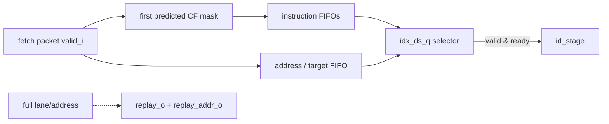

# Instruction Queue

**Evidence level:** RTL-established.

## Organization and ownership

`instr_queue` decouples fetch packets from decode with per-lane instruction FIFOs and an address/control-flow FIFO. CFG-01 has compressed instructions enabled and one issue port. The queue owns an instruction after its lane push succeeds; downstream ownership transfers on `fetch_entry_valid_o[0] & fetch_entry_ready_i[0]`. [Queue RTL](../../../../../core/frontend/instr_queue.sv#L46)

## Input rules

The first predicted control-flow instruction masks all later instructions in the same fetch packet. `idx_is_q` rotates incoming valid lanes onto FIFO slots. Pushes are independently inhibited for full lanes. `ready_o` is low when any instruction FIFO or the address FIFO is full. [Input path](../../../../../core/frontend/instr_queue.sv#L149)

If a required lane or address cannot be stored, `replay_o` asserts. With RVC enabled, `replay_addr_o` selects the first instruction not successfully pushed; an address FIFO overflow selects the packet base. This is a retry protocol, not silent loss.

## Output rules and state

`fetch_entry_valid_o[0]` asserts when at least one selected lane is nonempty. `idx_ds_q` rotates only on an actual downstream fire. `pc_q` advances by two or four bytes based on instruction encoding and is replaced with the first post-flush packet address when `reset_address_q` is set. [Output path](../../../../../core/frontend/instr_queue.sv#L300) [PC state](../../../../../core/frontend/instr_queue.sv#L439)

Flush resets FIFO ownership, selector state, and address reconstruction state. Backpressure holds FIFO heads, `idx_ds_q`, and `pc_q`.

## Exceptions and constraints

Fetch exception metadata is packet scoped on insertion and copied to the selected instruction. The queue does not decide architectural priority. Performance is bounded by the single downstream issue port and by the slowest full FIFO. Missing checks: pushed count equals consumed mask, replay points to the first rejected lane, and flush leaves every FIFO empty.
