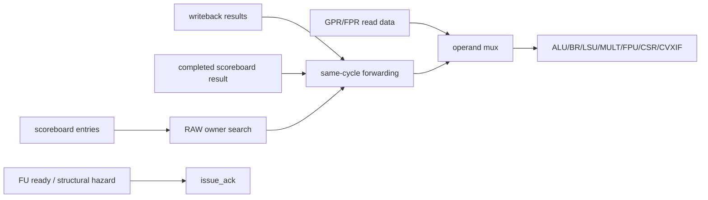

# Issue, Hazards, Operands, and Forwarding

**Evidence level:** RTL-established for equations and priority.

## Admission

`issue_read_operands` receives the scoreboard issue candidate, reads integer/FP register files, detects RAW and structural hazards, chooses forwarding, and dispatches one active CFG-01 instruction. Issue acknowledgement is withheld until operands are available and the selected FU can accept the request. [Issue operands](../../../../../core/issue_read_operands.sv#L17)

## RAW detection and forwarding

For each source register, owner search identifies the youngest older scoreboard writer. Register zero is excluded for integer dependencies. `rs1_valid`, `rs2_valid`, and `rs3_valid` reflect availability of the selected forwarding result. Operand selection gives the resolved forwarded value to a dependent source; otherwise it uses the register-file value or operation-specific immediate/PC/zero selection. [Hazard result validity](../../../../../core/issue_read_operands.sv#L536) [Forward mux](../../../../../core/issue_read_operands.sv#L682)

The forwarding pool includes current writeback ports and stored completed scoreboard results. The exact winner is the indexed owner computed by hazard logic, avoiding a generic “nearest port” rule. CSR source handling is separately gated because the encoded rs1 field can be an immediate.

## Structural hazards and dispatch state

Structural logic checks the selected FU, LSU/FPU/CVXIF readiness, and special serialization rules. On valid plus acknowledge, a registered valid bit is set for exactly the selected execution path. The final flush assignment clears those dispatch valids. [Structural hazards](../../../../../core/issue_read_operands.sv#L330) [Dispatch](../../../../../core/issue_read_operands.sv#L862)

Operand/FU input registers hold transaction ID and operand/control payload for multicycle units. A stalled request retains ownership until its unit accepts it. CV-X-IF has separate issue, register, and commit handshakes; with `COPRO_NONE`, custom instructions should be rejected and decoded as illegal.

## Performance and checks

Single issue limits allocation to one instruction per cycle. Five writeback observation ports do not create five-wide issue. Required dynamic checks are both forwarding cases, load-use stall release, FU backpressure stability, and simultaneous flush versus dispatch.
