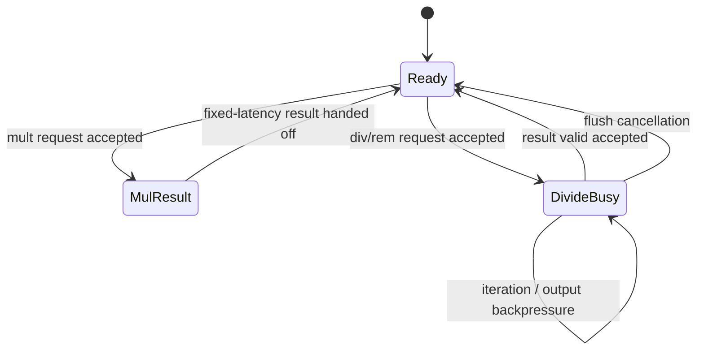

# Multiplier and Divider

**Evidence level:** RTL-established for structure and handshake; operation latency is not dynamically measured.

## Structure

`mult` selects multiplication or division behavior and retains the transaction ID with the operation. Multiplication uses `multiplier`; division uses the serial divider path and reports busy/valid until completion. [Mult unit](../../../../../core/mult.sv#L16) [Multiplier](../../../../../core/multiplier.sv#L15)

The diagram is structural: exact iteration count and output cycle require a waveform. The multiply result enters the fixed-latency result arbitration. Divide holds operation context until its result valid condition.

## Correctness points

Signedness and high/low product selection are derived from the operation encoding. Divide by zero and signed overflow follow the RISC-V defined results in the divider logic. Transaction ID must remain stable from acceptance to completion. A flush must cancel a killed operation's architectural completion even if internal arithmetic continues.

## Resource limit and checks

There is one multiply/divide issue resource, so a long divide creates a structural hazard for later M-extension operations. Assertions should cover request acceptance only while ready, stable payload while busy, exactly one completion per accepted operation, and no post-flush normal writeback.
