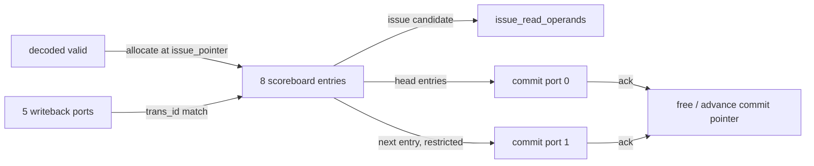

# Scoreboard

**Evidence level:** RTL-established; cycle examples remain open.

## State and identifiers

The scoreboard is an eight-entry circular instruction ownership structure. Its 3-bit index is the architectural transaction ID carried through execution and writeback. It stores decoded entry data, issued/completed status, results, and exceptions. Allocation and commit pointers are separate. [Scoreboard](../../../../../core/scoreboard.sv#L20)

## Update order

Combinational next state starts from the registered array and pointers. Decode allocation writes the issue slot. Issue acknowledgement marks its selected entry issued. Each valid writeback port indexes an entry by `trans_id` and updates result/exception/completion only for an issued owner. Commit acknowledgement releases the head entry and advances in order. A full flush clears scoreboard validity/ownership last. [Scoreboard update](../../../../../core/scoreboard.sv#L170)

The pointer order makes retirement in order even when functional units finish out of order. Port 1 observes the entry after port 0 and is only useful when the commit stage accepts both. Head-of-line blocking occurs whenever the oldest entry is incomplete or has a side effect whose commit condition is not ready.

## Hazards and cancellation

The scoreboard exposes register ownership and completion to issue logic. A RAW consumer can use a matching same-cycle writeback result or a completed scoreboard value; otherwise it stalls. `SpeculativeSb=0` removes the speculative branch mask mechanism. Branch mispredict flushes unissued work; global exception/control flush clears the scoreboard according to controller scope.

## Invariants

- A valid writeback must address its still-issued owner.
- Allocation must not overwrite a live slot.
- Commit pointer advances only for acknowledged head entries.
- Port 1 cannot retire without port 0.
- Flush prevents later writeback for killed IDs from creating valid architectural state.

Existing source assertions cover selected overflow/ordering cases; the complete proposals are in [assertion catalog](../verification/assertion_catalog.md).
