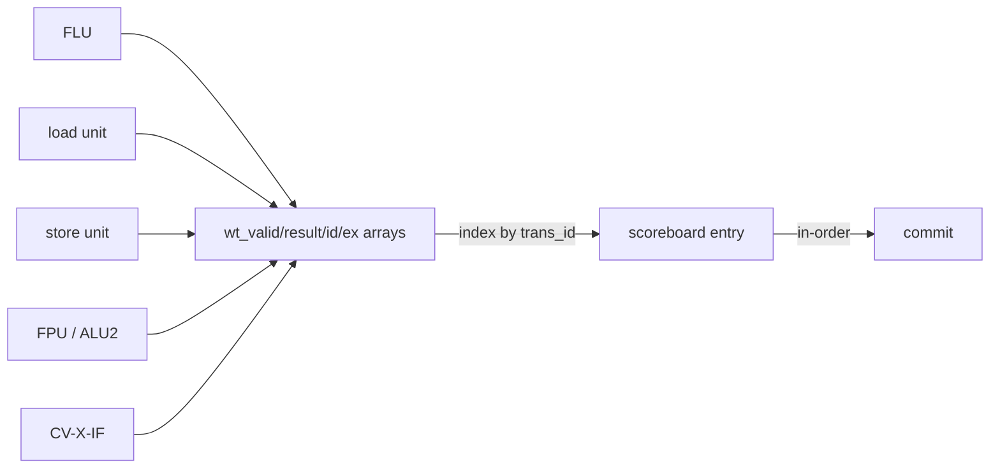

# Writeback Network

**Evidence level:** RTL-established.

## Ports and ownership

CFG-01 presents five writeback observations to the scoreboard. Results originate from fixed-latency integer/branch/multiply arbitration, load, store, FPU/ALU2, and CV-X-IF plumbing. Each valid transfer carries a scoreboard `trans_id`, result, and exception metadata. [Issue-stage writeback interface](../../../../../core/issue_stage.sv#L141) [EX stage](../../../../../core/ex_stage.sv#L397)

## Update semantics

Writeback is completion into speculative scoreboard state. It is not architectural retirement. A port may update only the entry whose current issued owner matches the transaction ID. Exceptions replace/suppress the normal completion meaning for that instruction and are later selected at the commit head.

Same-cycle results also feed the issue forwarding network. Completed values retained in the scoreboard form a second forwarding class on later cycles. Consequently a consumer can advance before its producer retires, while the commit pointer still preserves architectural order.

## Hazards and checks

The design relies on distinct active producer/port assignments; simultaneous writes to one scoreboard entry should be impossible. Required assertions: every writeback ID owns a live issued entry, no two ports update one owner, killed IDs cannot become complete, exception metadata remains attached to its owner, and forwarding data equals the value stored into that entry.
