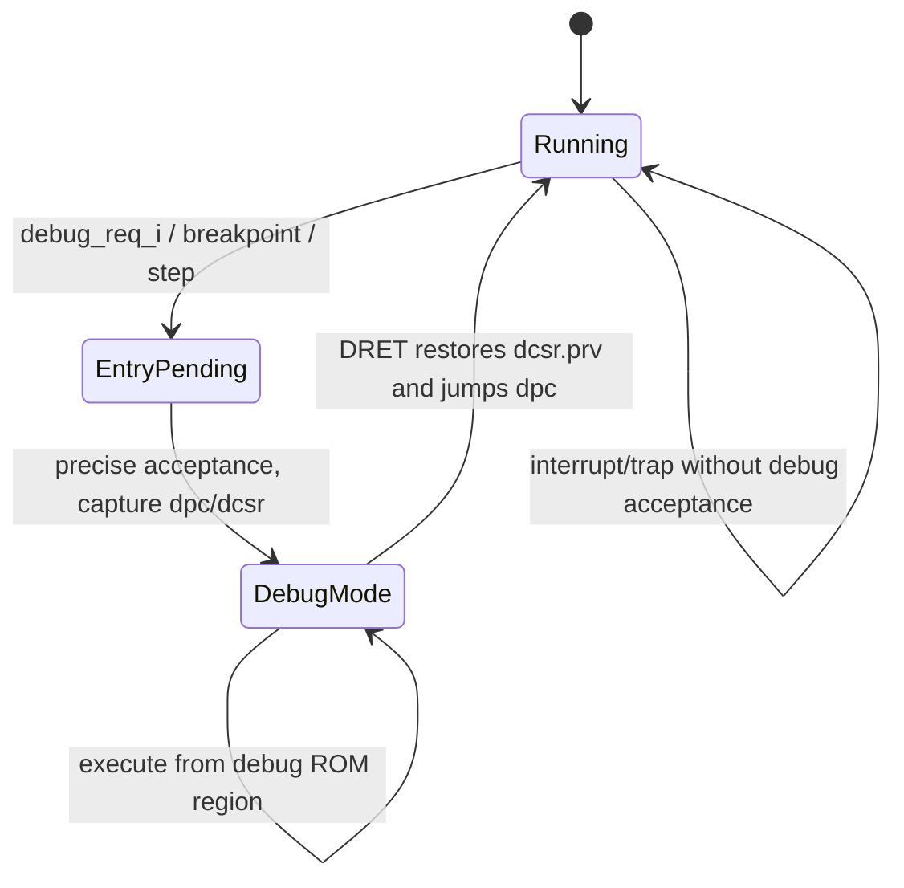

# Debug Entry and Exit

**Evidence level:** RTL-established for state/control path; concurrency trace remains open.

CFG-01 enables debug and disables Sdtrig. Debug entry captures `dpc_q`, records cause and previous privilege in `dcsr_q`, asserts debug mode, and redirects to `DmBaseAddress + HaltAddress`. Exceptions while already in debug select `DmBaseAddress + ExceptionAddress`. [Debug state](../../../../../core/csr_regfile.sv#L1011) [Frontend debug PC](../../../../../core/frontend/frontend.sv#L409)

While debug mode is set, reported execution privilege is M, normal interrupts are globally disabled, cache behavior follows CSR outputs, and debug-only CSR addresses are accessible. DRET has no ordinary CSR read/write side effect; it restores execution using DPC and saved privilege controls.

Debug PC is the last assignment in the frontend mux, so an asserted `set_debug_pc_i` wins the fetch target over trap/return/commit restart in that cycle. Architectural acceptance still depends on the CSR/controller sequence, which must be tested for simultaneous debug request and interrupt.

Required checks: correct DPC for halt request/step/exception causes, no double entry, interrupt remains pending across debug when appropriate, DRET restores privilege and PC, and reset clears debug mode/DPC while initializing `dcsr.xdebugver` and privilege.
