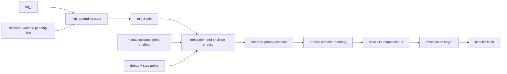

# Interrupt Acceptance

**Evidence level:** RTL-established for enable/pending/priority path; exact acceptance cycles are open.

Raw interrupt inputs update/read through `mip`; enabled candidates are masked by `mie`, global privilege enables, delegation, debug mode, and single-step policy. `irq_ctrl_o.global_enable` is false in debug and respects `dcsr.step/stepie`. [IRQ controls](../../../../../core/csr_regfile.sv#L2480)

Multiple eligible interrupts are prioritized before presentation to commit. External interrupts have priority over software, then timer, before synchronous traps at the relevant selection boundary as documented in commit logic. Delegation routes an accepted interrupt to S mode when `mideleg` selects it and current privilege allows delegation.

Acceptance occurs at a precise retirement boundary. Older instructions can complete/retire first; younger state is flushed. If the pipeline is stalled on an older memory instruction, a pending interrupt remains pending until that boundary is available. WFI clears for any enabled pending interrupt, debug request, or supervisor external wake condition. [WFI](../../../../../core/csr_regfile.sv#L2662)

Required traces: interrupt during load miss, interrupt with dual-commit opportunity, delegated S interrupt, masked interrupt, and interrupt during WFI. The saved-PC rule must be checked from observed cycles.
