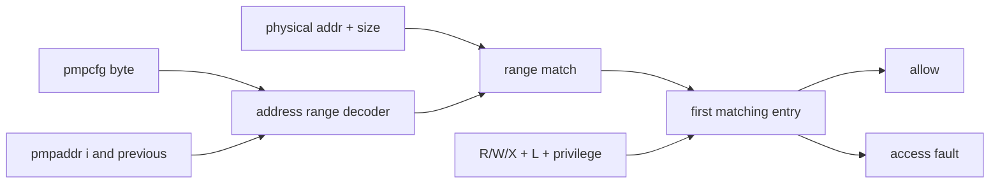

# PMP Inventory

**Evidence level:** RTL-established for eight active entries.

| Item | CFG-01 behavior |
|---|---|
| Entry count | 8 (`pmpaddr0` through `pmpaddr7`). |
| Configuration CSRs | RV64 packing in `pmpcfg0` and `pmpcfg2`; unavailable bytes/CSRs read as zero or illegal per decode. |
| Reset | all address/config state zero, so no entry is active. |
| Address modes | OFF, TOR, NA4 where supported by granularity, and NAPOT; NAPOT support enabled. |
| Permissions | independent R/W/X with reserved/illegal combinations constrained by implementation. |
| Priority | lowest-numbered matching entry wins. |
| Lock | locked config/address and dependent TOR boundary cannot be rewritten until reset. |
| M-mode | unlocked entries normally do not restrict M; locked entries apply according to PMP rules. |
| S/U mode | a matching entry must grant requested access; unmatched access fails when PMP is implemented. |
| Checked agents | instruction fetch, load/store effective physical access, and implicit PTW PTE reads. |

## Entry datapath

The top module fans CSR entries into the PMP logic; `pmp_entry` forms range masks and permissions. [PMP implementation](../../../../../core/pmp/src/pmp.sv#L17) [Entry implementation](../../../../../core/pmp/src/pmp_entry.sv#L17)

Required coverage crosses every entry index, mode, requested access, privilege, lower/upper boundary, lock state, and original-versus-PTW access. A denied request must have zero downstream normal cache request acceptance.
