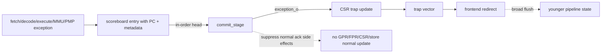

# Precise Exception Argument

**Evidence level:** RTL-established safety argument; exhaustive dynamic proof remains open.

## Safety chain

1. Each issued instruction receives one scoreboard owner and carries its PC and exception metadata.
2. Functional-unit completion writes only that owner by transaction ID.
3. The commit pointer exposes instructions in allocation order, independent of completion order.
4. `commit_stage` selects exceptions only from the oldest visible entry and suppresses its normal architectural result.
5. Trap CSR updates capture EPC/cause/tval from that entry and compute the target privilege/vector.
6. The controller invalidates younger frontend, ID, issue, and EX state.
7. Speculative stores are removed by flush; already committed stores are older architectural effects and continue draining.

The argument establishes precise state under the assumptions that transaction IDs are not reused early, every killed FU completion is rejected, and external pre-reset responses cannot alias new owners. Those assumptions are explicit verification obligations.

## Exception priority

CSR access exceptions are formed at commit. Exception metadata already carried by the instruction is assigned later and therefore has priority where both appear. Interrupt priority is computed in CSR/interrupt control. A synchronous exception at the oldest instruction prevents a younger completed entry on port 1 from retiring.

## Required proof obligations

- No architectural write enable when the head exception is valid.
- Port 1 acknowledgement is zero on any port-0 exception/trap event.
- All younger valid state clears after the trap edge.
- A flushed store never transfers into the committed queue.
- A post-flush load/FPU/CVXIF result cannot match a new scoreboard owner using a stale ID.
- EPC selects the faulting instruction for synchronous exceptions and the next precise PC for interrupts.
