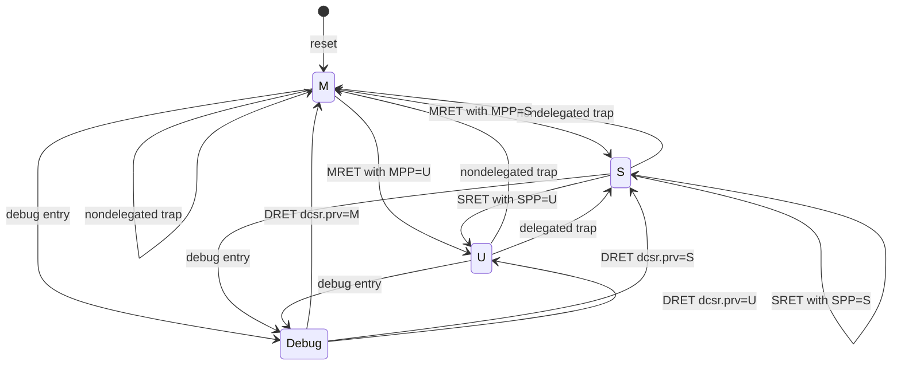

# Privilege Transitions

**Evidence level:** RTL-established for CFG-01 M/S/U path. Hypervisor transitions are inactive.

Reset initializes `priv_lvl_q` to M. Trap delegation uses `medeleg/mideleg` and current privilege; M-mode traps are not delegated downward. Trap entry saves prior interrupt-enable and privilege fields, disables the target mode's interrupt enable, captures EPC/cause/tval, and changes `priv_lvl_q`.

MRET restores privilege from MPP and interrupt enable from MPIE, then normalizes saved fields. SRET similarly uses SPP/SPIE. Both are privilege checked; `mstatus.tsr` can make SRET illegal outside M. Return PC comes from MEPC or SEPC through `epc_o`. [Return decode](../../../../../core/csr_regfile.sv#L2461) [Privilege output](../../../../../core/csr_regfile.sv#L2677)

For data accesses, MPRV can substitute MPP as effective privilege while instruction fetch stays at current privilege. In debug, `dcsr.mprven` controls whether MPRV remains effective. SUM/MXR and page permissions further modify S/U access checks. Sv39 translation is enabled in non-M mode when SATP mode matches the configured VM mode.

Required tests cover delegation, nested trap status stacks, MRET/SRET illegal cases, MPRV loads/stores, SUM/MXR, and DRET from each saved privilege.
