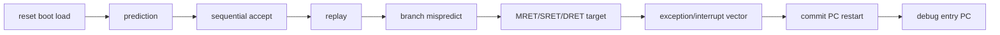

# Redirect and Architectural Event Priority

**Evidence level:** RTL-established for controller/frontend assignment priority; concurrent architectural effects are inferred where acceptance is split across modules.

## PC mux order

Later assignments win in `frontend.npc_select`:

[NPC RTL](../../../../../core/frontend/frontend.sv#L355)

## Pairwise outcome matrix

Rows are candidate events; columns are concurrent events. `row`/`column` names the effective PC winner. `defer` means the losing level-sensitive request remains eligible later. `masked` means its current pulse is consumed by the wider recovery.

| Row \ Column | Sync exception | Interrupt | Debug request | Branch redirect | Replay | CSR flush | Fence/FENCE.I/SFENCE | Return | WFI wake |
|---|---|---|---|---|---|---|---|---|---|
| Reset | reset | reset | reset | reset | reset | reset | reset | reset | reset |
| Sync exception | row | CSR priority decides one trap | debug PC if entry asserted | row; branch masked | row | commit restart mux can override; should be mutually gated | row/older head decides | row | row |
| Interrupt | CSR priority decides one trap | highest enabled IRQ | debug PC if entry asserted; IRQ deferred | row; branch masked | row | commit restart can override PC mux | older commit event first | trap/return acceptance decides | row |
| Debug request | debug PC when `set_debug_pc_i` | debug PC; IRQ pending | row | row | row | row | older noninterruptible side effect may delay entry | row | row |
| Branch redirect | column | column | column | row | row | column | column | column | row |
| Replay | column | column | column | column | row | column | column | column | row |
| CSR flush | architectural trap/exception suppresses normal CSR | accepted interrupt waits precise boundary | debug PC has mux priority | row | row | row | oldest commit operation decides | return has lower PC mux priority than commit restart | row |
| Fence family | exception at head prevents normal fence | interrupt boundary determined at commit | debug may wait for maintenance halt | row | row | oldest commit operation decides | operation subtype controls cache/TLB flush | return is a different head operation | row |
| Return | column | exception/interrupt PC mux later | debug PC | row | row | column | column | row | row |

This table records the implemented control relationships, not proof that every pair can be asserted legally in one cycle. The most important open pairs are debug plus interrupt, trap plus commit restart, and SFENCE plus PTW response.

## Saved-state and flush rules

| Event | Saved PC/cause | Flush scope | Outstanding memory |
|---|---|---|---|
| Synchronous exception | faulting head PC and exception cause/tval | IF, unissued, ID, EX, predictor | committed stores and accepted cache/AXI traffic drain. |
| Interrupt | next precise architectural PC and selected interrupt cause | same broad trap scope | same as above. |
| Debug entry | DPC and DCSR cause/prv | broad scope; frontend to debug halt address | committed/external traffic remains owned. |
| Branch mispredict | no trap CSR | IF and unissued younger state | older issued work remains. |
| CSR/AMO restart | no trap unless CSR access faults | broad scope; restart at commit PC+4/current PC when halted | committed effects remain. |
| Return | privilege/status restored; PC from EPC/DPC | broad scope | committed/external traffic remains. |
| FENCE.I/SFENCE | no trap on legal op | broad scope plus selected cache/TLB maintenance | waits documented drain/busy conditions. |
