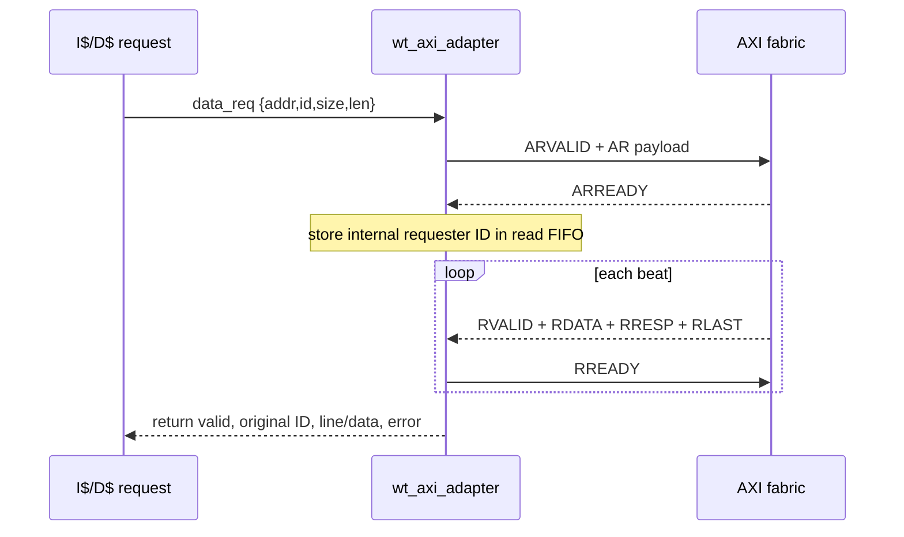
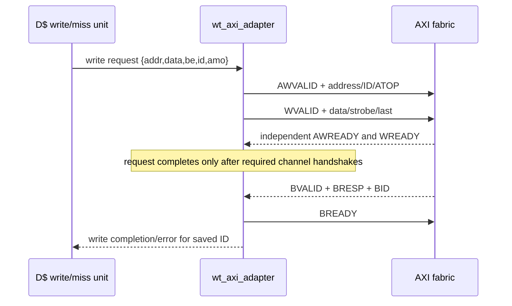

# AXI Transactions

**Evidence level:** RTL-established for adapter protocol structure; no external timing was observed.

`wt_axi_adapter` arbitrates I-cache reads and D-cache reads/writes, maps internal memory transaction IDs into AXI IDs, records outstanding IDs in FIFOs, assembles line beats, and returns responses to the requesting cache. [AXI adapter](../../../../../core/cache_subsystem/wt_axi_adapter.sv#L17)

## Read transaction

## Write transaction

AW and W are independent AXI channels; reasoning must use their individual handshakes rather than assume same-cycle acceptance. The adapter has outstanding-ID FIFOs for I-cache reads, D-cache reads, and D-cache writes, plus a B-response FIFO. [ID FIFOs](../../../../../core/cache_subsystem/wt_axi_adapter.sv#L376)

AXI errors are converted into cache return status. AMOs can use AXI atomic encodings and may synthesize/read returned data according to operation. Progress has no bounded latency because the external fabric may backpressure any channel.

Reset safety is open: adapter FIFOs reset locally, but a response from a separately reset external fabric could reuse an ID. Integration must reset/quiesce the fabric or provide an epoch/isolation guarantee.
