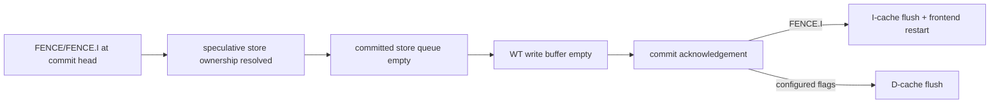

# Fences and Memory Ordering

**Evidence level:** RTL-established for commit gates and configured maintenance actions.

## Drain conditions

`no_st_pending_commit` combines the store buffer's committed-queue state with the WT D-cache write-buffer empty indication. Commit uses this condition to hold fences until older stores have progressed through both internal ownership stages. [Top-level drain](../../../../../core/cva6.sv#L1149)

For CFG-01, `DcacheFlushOnFence=0` and `DcacheFlushOnFenceI=0`. FENCE.I still initiates instruction-cache invalidation/frontend restart after older store state drains. A D-cache array flush is not selected by those configuration flags.

SFENCE.VMA captures rs1/rs2 operands in EX, reaches commit in order, requests the selected TLB invalidation, and restarts the pipeline. It must coordinate with an active PTW so a stale pre-fence fill cannot survive.

Architectural retirement, D-cache acceptance, AXI AW/W acceptance, and AXI B completion are different boundaries. Static RTL establishes internal drain gates, but whether a fence requires fabric-level B completion depends on when the WT buffer releases entries; this relationship must be confirmed by trace/assertion before claiming external completion ordering.

Required checks: fence cannot ack while either internal store stage is nonempty, FENCE.I invalidates fetch state, SFENCE waits for relevant flush busy state, and no younger memory operation crosses the restart boundary.
