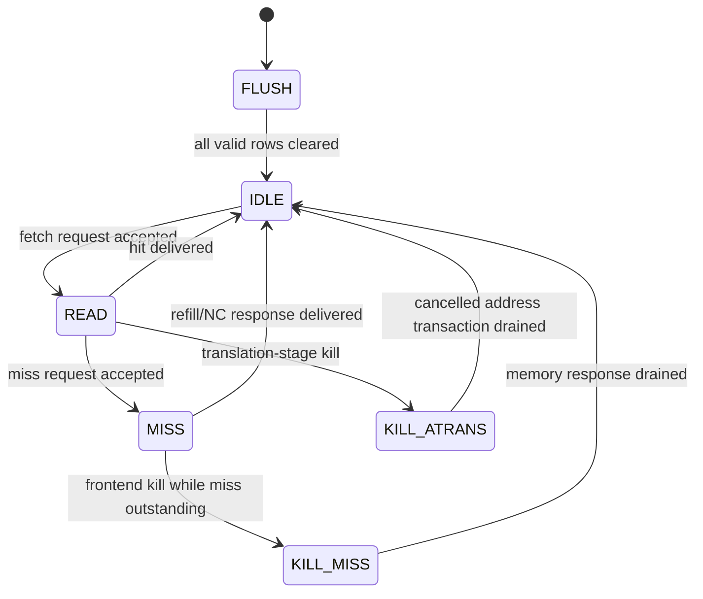
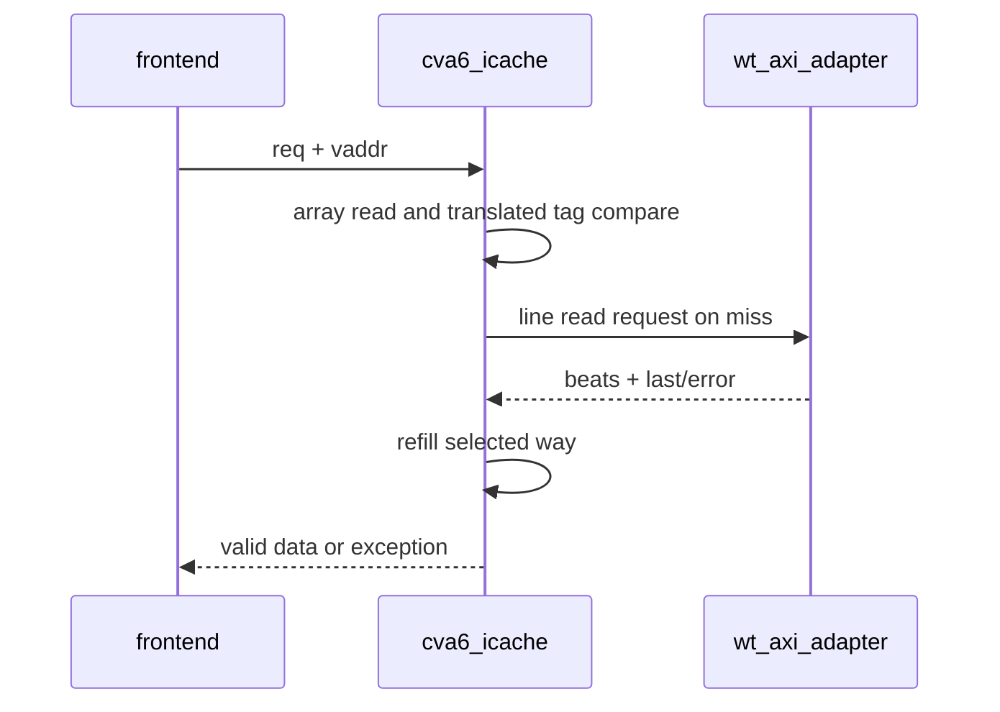

# Instruction Cache

**Evidence level:** RTL-established for active FSM and interfaces.

The active instruction cache is 16 KiB, four-way, 16-byte lines. Virtual index/request state is combined with translated physical tag/protection information. Noncacheable selection occurs when the cache is disabled or the physical address is outside configured cacheable regions. [I-cache](../../../../../core/cache_subsystem/cva6_icache.sv#L17)

The precise states are declared at [I-cache FSM](../../../../../core/cache_subsystem/cva6_icache.sv#L122). `kill_s1` and `kill_s2` from the frontend distinguish early and later cache-pipeline cancellation. A miss remains externally outstanding even when the requesting instruction stream is killed; the response must be drained without becoming a valid frontend result.

Required checks: kill at each state, no killed response delivery, refill beat assembly, error conversion, flush completion, and valid-bit reset coverage.
