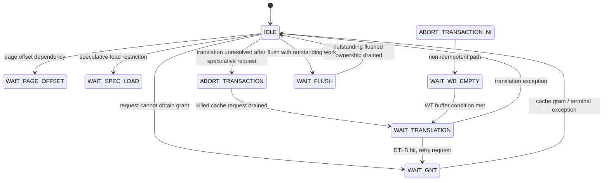
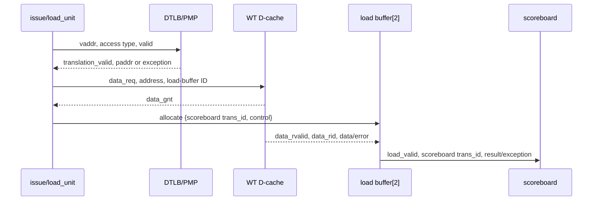

# Load Unit FSM

**Evidence level:** RTL-established for state transitions and ownership; latency remains open.

## Request and identity flow

The load unit receives an effective address, size/sign control, and scoreboard transaction ID. It coordinates translation/PMP results and the D-cache request port. Two load-buffer entries hold the cache response identity and corresponding scoreboard ID. [Load unit](../../../../../core/load_unit.sv#L16)

CFG-01 has `NonIdemPotenceEn=0` and `SpeculativeSb=0`; `ABORT_TRANSACTION_NI`, `WAIT_WB_EMPTY`, and speculative scoreboard behavior compile but are inactive after constant propagation. State declarations and transition logic are at [state enum](../../../../../core/load_unit.sv#L89) and [FSM](../../../../../core/load_unit.sv#L263).

## Acceptance and buffer allocation

An accepted D-cache grant allocates a free load-buffer slot and records the scoreboard ID plus operation metadata. The cache-side ID selects that slot. A response releases it and reconstructs the scoreboard writeback. Load extraction shifts by address offset, then applies sign or zero extension based on operation/size.

## Flush and faults

Flush marks live load-buffer entries flushed. A later cache response still releases the resource, while normal writeback is suppressed for the flushed owner. A same-cycle accepted grant and flush is resolved by the next-state assignment order so the new ownership is also marked flushed. Translation, alignment, PMP, and bus/cache errors become load exceptions attached to the scoreboard owner.

Required checks: no response without a live buffer ID, no ID reuse before response drain, grant-plus-flush suppression, and response-after-flush resource release without writeback.
