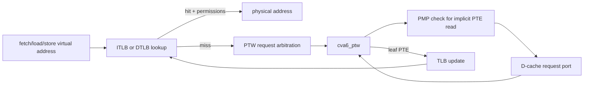
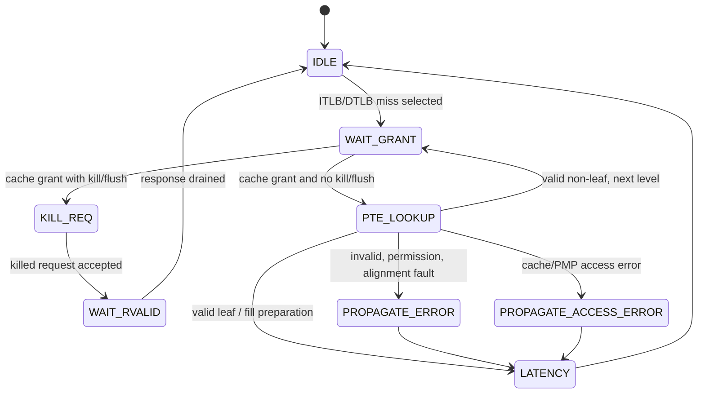

# MMU, TLB, and Page-Table Walker

**Evidence level:** RTL-established for Sv39 path and FSM. Concurrent SFENCE/PTW behavior requires dynamic or formal confirmation.

## Translation path

CFG-01 uses independent 16-entry ITLB and DTLB, Sv39, three page-table levels, 16-bit ASIDs, and no hypervisor second stage. Translation is bypassed in M mode unless effective privilege changes for data access. [MMU](../../../../../core/cva6_mmu/cva6_mmu.sv#L17) [TLB](../../../../../core/cva6_mmu/cva6_tlb.sv#L24)

## PTW state machine

The declared states are `IDLE`, `WAIT_GRANT`, `PTE_LOOKUP`, `WAIT_RVALID`, `PROPAGATE_ERROR`, `PROPAGATE_ACCESS_ERROR`, `KILL_REQ`, and `LATENCY`. [PTW enum](../../../../../core/cva6_mmu/cva6_ptw.sv#L105) [PTW transitions](../../../../../core/cva6_mmu/cva6_ptw.sv#L338)

At each level, the walker forms the PTE address from the current root/PPN and VPN slice, checks PTE validity and leaf permissions, descends on a valid pointer, or produces a page/access fault. Superpage alignment is checked before fill. Accessed/dirty requirements participate in leaf validity; no autonomous PTE A/D writeback is established for this configuration.

## Flush safety

TLB logic supports full and address/ASID selective invalidation. The PTW samples flush/kill and drains a request already granted through `KILL_REQ`/`WAIT_RVALID`. The intended invariant is that a pre-flush walk cannot refill stale translation state. This is a high-priority formal/dynamic check because same-cycle grant, response, and flush ordering spans modules.
