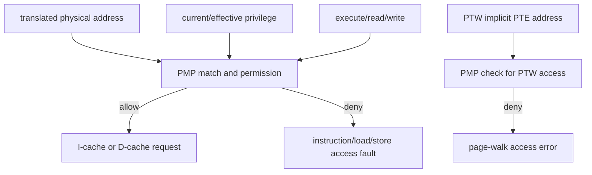

# PMP Checks

**Evidence level:** RTL-established for integration and entry count; exhaustive address-mode behavior is open.

CFG-01 implements eight PMP entries with NAPOT support. CSR state supplies configuration/address entries to `pmp`, which evaluates privilege, access type, and physical address. [PMP](../../../../../core/pmp/src/pmp.sv#L17)

Instruction, data, and implicit page-table accesses require distinct checks. Data accesses use the effective privilege derived from current mode and MPRV rules. A denied original access must not issue a normal cache/external request. A denied PTE fetch becomes an access error attributed to the original translation operation.

Priority across entries follows PMP entry order; unmatched behavior depends on privilege and implementation rules. Locked entry behavior and TOR/NA4/NAPOT masks are implemented in `pmp_entry`. [PMP entry](../../../../../core/pmp/src/pmp_entry.sv#L17)

See [PMP inventory](../control/pmp_inventory.md). Required tests cover first-match priority, boundary bytes, M-mode locked/unlocked behavior, execute-versus-read permissions, MPRV, and PTW denial.
