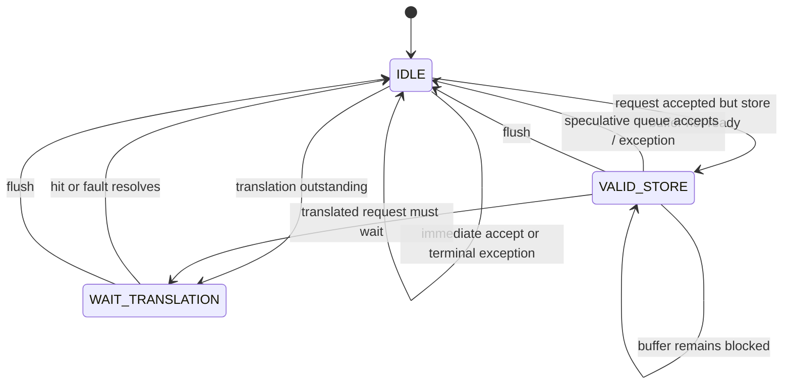

# Store Unit FSM

**Evidence level:** RTL-established.

## Function

The store unit computes byte enables and aligned write data, waits for address translation/protection, and inserts a successful store into the speculative store queue. Its execution writeback reports that the speculative store operation has been captured; memory ownership continues in `store_buffer`. [Store unit](../../../../../core/store_unit.sv#L16)

The active state enum also declares `WAIT_STORE_READY`; current CFG-01 transition logic principally uses `IDLE`, `VALID_STORE`, and `WAIT_TRANSLATION`. [State enum](../../../../../core/store_unit.sv#L124) [Transitions](../../../../../core/store_unit.sv#L173)

## Data formation and faults

The effective address selects the byte lane. Store size determines byte enables; source data is replicated/shifted into the XLEN word. Misalignment, page permission, and PMP failures prevent a normal queue insertion and return exception metadata through the store writeback port.

## Flush and ownership

Flush returns the request FSM to `IDLE`. If the store has already entered the speculative queue, queue-level flush removes it. Once commit transfers it into the committed queue, ordinary pipeline flush cannot cancel it. Assertions should tie one successful store-unit completion to one speculative queue entry and forbid insertion on any protection fault.
