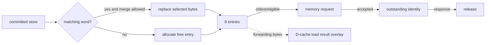

# WT Write Buffer

**Evidence level:** RTL-established.

The eight-entry write buffer decouples committed stores from AXI progress. An entry holds aligned word tag/address, data, per-byte valid bits, user metadata, and state needed for memory issue. [Write buffer](../../../../../core/cache_subsystem/wt_dcache_wbuffer.sv#L17)

Byte-valid masks permit partial-store merging to the same aligned word. Read lookup produces matching buffered bytes, which override array/refill bytes in `wt_dcache_mem`. This is the local ordering mechanism that lets a later load see an older store before AXI completion. [Overlay](../../../../../core/cache_subsystem/wt_dcache_mem.sv#L249)

`wbuffer_empty_o` distinguishes complete drain. `wbuffer_not_ni_o` supports non-idempotent ordering; CFG-01 disables configured non-idempotent regions, so that specialized load serialization is inactive. Flush/drain coordination belongs to the D-cache miss unit; committed content cannot be discarded by a pipeline redirect.

Required checks: merge only for matching address/attributes, newest buffered byte wins, a full buffer backpressures new stores, each issued entry receives exactly one completion, and fence acknowledgement waits for the documented empty condition.
