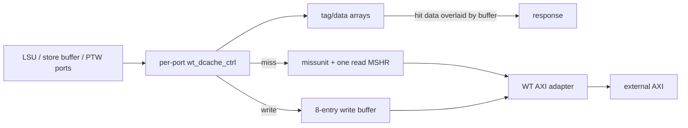

# Write-Through D-Cache

**Evidence level:** RTL-established.

CFG-01 selects `wt_cache_subsystem` and a 32 KiB, eight-way, 16-byte-line D-cache. Request ports serve loads, committed stores, PTW, and maintenance/AMO traffic through arbitration. [Subsystem](../../../../../core/cache_subsystem/wt_cache_subsystem.sv#L17) [D-cache](../../../../../core/cache_subsystem/wt_dcache.sv#L17)

Each controller uses `IDLE`, `READ`, `MISS_REQ`, `MISS_WAIT`, `KILL_MISS`, `KILL_MISS_ACK`, `REPLAY_REQ`, and `REPLAY_READ`. [Controller FSM](../../../../../core/cache_subsystem/wt_dcache_ctrl.sv#L61) The miss unit uses `IDLE`, `DRAIN`, `AMO`, `FLUSH`, `STORE_WAIT`, `LOAD_WAIT`, and `AMO_WAIT`, with one read MSHR carrying physical address, size, valid ways, memory ID, cacheability, replacement way, and source port. [Miss unit](../../../../../core/cache_subsystem/wt_dcache_missunit.sv#L110)

On a load hit, cache data is byte-overlaid with matching write-buffer bytes before response, preserving read-after-write visibility. On a miss, the MSHR serializes the refill/noncacheable request. Writes update the cached word when present and always flow through the WT buffer toward memory.

Flush invalidates cache state and coordinates with outstanding miss/write activity. Its acknowledgement is a controller-visible completion boundary. Assertions already check one-hot writes and known response data; additional properties must cover transaction ID ownership, killed miss drain, and buffer overlay precedence.
